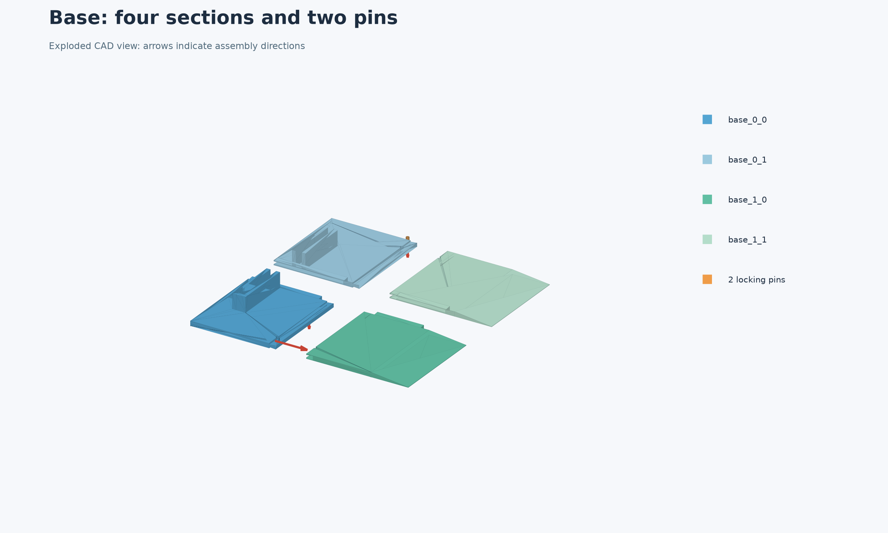
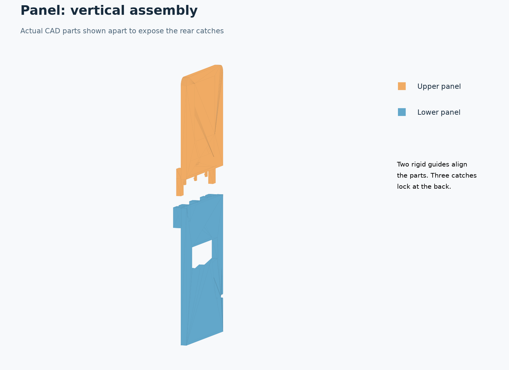

# MicroDock V2 for Bambu Lab A1 Mini

A printable, experimental adaptation of [Vottivott's MicroDock V2](https://github.com/Vottivott/microduck-playground/tree/main/hardware/microdock-v2) for the Bambu Lab A1 Mini. The base is split into sliding sections, and the panel uses three rear snap-fit catches and two alignment guides. The AprilTag is a printed sticker.

## Choose a version

- **[Replacement ramp — large PLA pin](MicroDock_Ramp_PLA.3mf):** two new front base sections and one large split pin, on two plates. Use this with the two original rear base sections, panel, hood and keeper. The short front T-joint and its pin are based on the easier-fit coupon reported to fit better. The full-size replacement has not yet been physically tested.
- **[Original complete project — supports](MicroDock_A1_Mini_PLA.3mf):** all four original split base sections, panel and original small pins. Use this project if printing the complete original A1 Mini adaptation.
- **[Original complete project — no supports](MicroDock_A1_Mini_PLA_NoSupports.3mf):** the same original geometry for manual support setup. Inspect the preview and add support where needed.

These are **separate projects**: the complete projects still contain the original ramp. To use the replacement ramp, print its two plates and use the rear sections and panel from the original project. The rear-to-front joint is unchanged and still uses the original small pins; their difficult fit is **not resolved** by the larger ramp pin.

### Replacement ramp

| Plate | Contents | Estimated PLA | Estimated time |
|---|---|---:|---:|
| 1 | Ramp A and large PLA pin | 31.8 g | 58 min |
| 2 | Ramp B | 31.3 g | 58 min |

The [replacement STL files](STL/) are `ramp_A_short_joint.stl`, `ramp_B_short_joint.stl` and `large_lock_pin.stl`. STL files do not include supports. The 3MF uses normal automatic support on model surfaces; reslice for your filament and inspect both the underside of the male guides and the enclosed female channels. Remove supports carefully. The new guide ends are short, but they still have overhangs.

Slide the two new ramp halves together, then insert the large pin from above with the split end down and the head seated flush. Do not force it. Slide the assembled ramp onto the existing rear assembly using its original joint. Check that the base lies flat and that the pin does not loosen. The older rear-to-front joint and pins retain their previous limitations. The base image below illustrates the **original** joint, not the new short T-joint.

### Fit-test projects

| Project | Purpose |
|---|---|
| [PLA Pin Easy — complete](tests/PLA_Pin_Easy_Complete.3mf) | Both halves and the easier-fit pin; this is the coupon that was reported to fit better. |
| [PLA Pin Easy — reuse male](tests/PLA_Pin_Easy_Reuse_Male.3mf) | Female half and easy pin only; reuse the male half from the first pin test. |
| [PLA Pin — first version](tests/PLA_Pin_Test.3mf) | Earlier, tighter PLA pin and guide coupon. |
| [Insert and snap studies](tests/Insert_and_Snap_Tests.3mf) | Early experiments, not used in the replacement ramp. The snap study does not establish upward retention; the insert study requires metal hardware. |
| [Insert bridge study](tests/Insert_Joint_Test.3mf) | Earlier insert-only study requiring metal screws and heat-set inserts. |

The printed easy-fit coupon is encouraging, but does not prove full-size printability, strength, pin retention over time, or fit to already-printed parts. The wider tolerances reduce friction and may also allow play. Inspect and test the full-size assembly before use.

## Original complete projects

Two Bambu Studio projects are available:

- **[MicroDock_A1_Mini_PLA.3mf](MicroDock_A1_Mini_PLA.3mf)** — recommended: supports are configured, including inside both female base channels.
- **[MicroDock_A1_Mini_PLA_NoSupports.3mf](MicroDock_A1_Mini_PLA_NoSupports.3mf)** — the same parts with supports disabled for manual setup. Bambu Studio reports unsupported areas on plates 1–5 and 7. Do not print those plates as-is without checking the preview and adding appropriate supports or changing the orientation.

Both projects are set up for the A1 Mini, a 0.4 mm nozzle, 0.20 mm layers, textured PEI plate and Bambu PLA Basic. Select the appropriate profile and reslice if you use a different filament or build plate. The [STL files](STL/) contain only geometry, without generated supports.

| Plate | Contents | Estimated PLA | Estimated time |
|---|---|---:|---:|
| 1–4 | Four base sections | 131.4 g | 4 h 03 min |
| 5 | Two fit-test pieces | 11.8 g | 38 min |
| 6 | Lower panel | 47.9 g | 72 min |
| 7 | Upper panel and two base locking pins | 40.4 g | 64 min |

With the recommended supports and without the test plate, the estimate is approximately **220 g and 6 h 18 min**. Times and filament use depend on the printer and settings. The hood and keeper are not included in the project: reuse the original parts or obtain them from the [original Microdock](https://github.com/Vottivott/microduck-playground/tree/main/hardware/microdock/stl).

Individual files are available in [STL/](STL/). If printing these separately, print **two** copies of `base_lock_pin_print_2.stl`. The 3MF already includes both pins.

## Test the panel joint first

The updated test piece removes the earlier model's nominal 0.2 mm gap between panel faces. Print plate 5 and check that the catch engages, releases and returns without excessive force. If you already printed the earlier lower test piece, it is unchanged and can be reused. Check for support residue, whitening, cracks or permanent deformation before printing the full panel.

## Original project assembly

1. Slide the two rear base sections together, then slide the two front sections together.
2. Slide the front group sideways onto the rear group. Align the holes and press in the two pins. Check the fit without forcing them.
3. Insert the upper panel vertically into the lower panel. The two rigid guides align the halves; the three rear catches retain them.
4. To release the panel, press the three catches through the rear openings toward the panel while gently lifting the upper half. A small blunt tool may help; do not force the printed arms.
5. Insert the panel into the base, then install the original hood and keeper as shown in the [original assembly manual](https://github.com/Vottivott/microduck-playground/blob/main/hardware/microdock-v2/media/microdock_v2_assembly.pdf).

The images show actual CAD geometry with components separated and coloured to make assembly easier to follow.

## AprilTag sticker

Print [AprilTag_36h11_ID0_60mm.svg](AprilTag_36h11_ID0_60mm.svg) in black on white adhesive paper at **100% / actual size**, without fitting to page. Measure the outside square: it must be **60 × 60 mm**. Preserve the white border and the orientation; this is AprilTag 36h11 ID 0, not a QR code.

Place the sticker flat and centred horizontally on the front of the upper panel. Its centre is **39 mm below the top edge**; a 60 mm sticker therefore starts approximately 9 mm below the top and 25 mm from each side. Camera recognition with the sticker has not yet been tested.

## Supports and validation

The replacement ramp was digitally checked for closed meshes, nominal sliding and vertical interlock, and matching of the original ramp and rear interface. Bambu Studio sliced both plates without warnings. The full-size ramp and rear-to-front physical fit remain untested; the latter still uses the old joint. See Preview for actual supports.

Both panel faces are oriented toward the bed. The sticker face does not need support underneath it; the tested slicer setup generated no support for the lower panel and some support on the back of the upper panel and on the base. The recommended project enables normal supports on model surfaces as well as the build plate for **all four base parts**. This allows supports inside the female channels, including the front ramp section on plate 4. Supports are generated by slicing: open the recommended 3MF, select the plate, click **Slice plate**, and inspect support in **Preview**. The 3MF does not contain pre-sliced toolpaths. Remove support carefully around the guides and flexible catches.

The panel meshes were checked for closed geometry and assembled clearances. Bambu Studio 02.09.01.70 sliced all seven plates of the supported project without warnings; the support-free project produced floating-region warnings on six plates. The user reported a successful print with internal support on the rear female base; the front female section has the same support approach but has not yet been physically verified. The updated joint, long-term PLA strength, sticker recognition and the complete dock still require physical testing. The base is 2 mm thicker than the original and has a modified ramp; robot approach on that ramp has not been verified.

## Attribution and license

This project adapts [MicroDock V2 by Vottivott](https://github.com/Vottivott/microduck-playground). The hardware designs are distributed under [CC BY-NC-SA 4.0](LICENSE-HARDWARE), which restricts commercial use. This adaptation includes modified base and panel geometry and print layouts.
